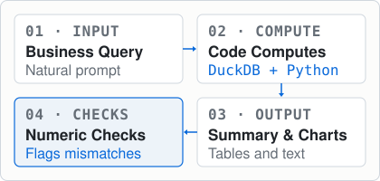
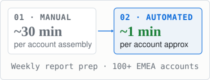
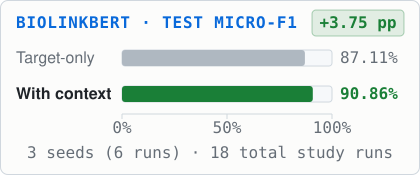

# Muhammad Ikram Hafeez

<picture>
  <source media="(prefers-color-scheme: dark)" srcset="assets/profile/masthead-dark.svg">
  
</picture>

  <strong>Computer Science &amp; Engineering student building AI, data and automation systems.</strong> 
  Based in Budapest at Óbuda University. At Xerox Client Delivery, I build workflows for an operations team supporting 100+ EMEA enterprise accounts. In research, I study contextual language models on biomedical benchmarks.

  <strong>Open to internships and part-time roles in AI, data and automation.</strong> 
  <a href="https://im-kaami.github.io/">Portfolio</a> &nbsp;&middot;&nbsp; <a href="https://github.com/im-kaami?tab=repositories">Code</a> &nbsp;&middot;&nbsp; <a href="https://im-kaami.github.io/contact.html">Contact</a> &nbsp;&middot;&nbsp; <a href="https://linkedin.com/in/ikram-hafeez">LinkedIn</a>

---

### 01 &middot; Build: InsightForge AI

<picture>
  <source media="(prefers-color-scheme: dark)" srcset="assets/profile/insightforge-flow-dark.svg">
  
</picture>

Analytics assistant where code computes results and numeric checks flag discrepancies in generated summaries for human review. Built with Next.js, FastAPI, DuckDB and Python statistical tooling.

&rarr; [Inspect repository](https://github.com/im-kaami/InsightForgeAI) &nbsp;&middot;&nbsp; [Project details and architecture](https://im-kaami.github.io/projects.html#insightforge)

---

### 02 &middot; Automate: Xerox Client Delivery

<picture>
  <source media="(prefers-color-scheme: dark)" srcset="assets/profile/xerox-reporting-dark.svg">
  
</picture>

I build workflows for an operations team supporting 100+ EMEA enterprise accounts. Automated weekly report preparation using Outlook, Power Automate, SharePoint and Excel VBA, reducing turnaround from approximately 30 minutes to 1 minute per account. Separately, built device-tracking workflows flagging equipment stalled for 40+ days, helping reduce the stalled-device backlog by about 25%.

Author of the device-tracking dashboard SOP and user guide; instructor for an internal Excel course covering basics through intermediate topics.

&rarr; [Reporting automation case study](https://im-kaami.github.io/experience/xerox/reporting-automation.html) &nbsp;&middot;&nbsp; [Device tracking](https://im-kaami.github.io/experience/xerox/device-tracking.html) &nbsp;&middot;&nbsp; [Request automation](https://im-kaami.github.io/experience/xerox/device-requests.html)

---

### 03 &middot; Investigate: Contextual Biomedical NLP

<picture>
  <source media="(prefers-color-scheme: dark)" srcset="assets/profile/biorc800-comparison-dark.svg">
  
</picture>

Evaluated contextual encoders across 18 fine-tuning runs (3 models &times; 2 conditions &times; 3 seeds on official BIORC800 splits). Adding surrounding sentence context improved BioLinkBERT's mean test Micro-F1 from 87.111% to 90.864% (+3.753 percentage points across the 6 BioLinkBERT runs).

&rarr; [Research methodology, complete runs and baseline comparisons](https://im-kaami.github.io/research.html)

---

### Team projects

- **[VeriVision](https://github.com/mariasiles/VeriVision)** &middot; European Impact Sprint &mdash; Claim-level verification for text and social video links returning verdicts with ranked sources. Built in four days with an international team of four using FastAPI, React and faster-whisper.
- **[Campus Copilot](https://im-kaami.github.io/projects.html#campus-copilot)** &middot; Óbuda AI Campus &mdash; Led a team of three developing a retrieval-augmented assistant grounded in university documentation to answer student queries from retrieved sources.
- **[AI Earphone](https://github.com/LiRongchuan/raspbot-public)** &middot; SUSTech &mdash; Team wearable project exploring fall detection, PPG heart-rate monitoring, voice interaction and adaptive noise reduction for elderly users.

### Coursework &amp; analytical projects

- **[Telecom Carrier Analysis](https://im-kaami.github.io/projects.html#telecom)** &middot; NED coursework &mdash; Power BI tariff analysis across 244 destinations and ~584M call minutes; analytical routing recommendations.

[Explore all projects on portfolio &rarr;](https://im-kaami.github.io/projects.html)

---

### Background &amp; Education

- **Experience:**
  - Automation &amp; Data Analytics Intern at Xerox Client Delivery (Aug 2025 &ndash; Present)
  - Sustainability Data Analyst Intern at Givaudan (Sep 2024 &ndash; Feb 2025 &middot; Sustainability data from 5+ systems, about 40% manual data entry reduction)
  - AI Research Assistant at Óbuda University Applied ML Research Group (Sep 2025 &ndash; Present)
  - Student Mentor at Milestone Institute (Apr 2026 &ndash; Present) &amp; HÖOK (Jul 2024 &ndash; Present)
  - Lead of SHS_PK Students Community (2022 &ndash; Present)
- **Education:**
  - **BSc in Computer Science &amp; Engineering**, Óbuda University, Budapest (Sep 2023 &ndash; Aug 2027 &middot; GPA: 4.71 / 5.00) &middot; Stipendium Hungaricum Scholar
  - **Diploma in Data Science with AI**, NED University (2025 &ndash; Present &middot; CGPA: 3.87 / 4.00 &middot; Weekend / Remote)
- **Tools:**
  - *AI &amp; NLP:* Python &middot; PyTorch &middot; Hugging Face Transformers &middot; scikit-learn &middot; LoRA / PEFT &middot; RAG
  - *Data &amp; Analytics:* SQL &middot; DuckDB &middot; Power BI &middot; Power Query &middot; DAX &middot; pandas &middot; NumPy
  - *Automation &amp; Delivery:* Power Automate &middot; Microsoft Forms &middot; Excel VBA &middot; SharePoint &middot; FastAPI &middot; Next.js &middot; Docker &middot; Git

 

Budapest, Hungary &nbsp;&middot;&nbsp; <a href="mailto:hafeez.muhammadikram@outlook.com">hafeez.muhammadikram@outlook.com</a> &nbsp;&middot;&nbsp; <a href="https://im-kaami.github.io/">im-kaami.github.io</a> &nbsp;&middot;&nbsp; <a href="https://linkedin.com/in/ikram-hafeez">LinkedIn</a>

