<picture>
  <source media="(prefers-color-scheme: dark)" srcset="assets/header-dark.svg">
  
</picture>

  <a href="https://im-kaami.github.io/">Portfolio</a>&nbsp;&nbsp;&middot;&nbsp;&nbsp;<a href="https://linkedin.com/in/ikram-hafeez">LinkedIn</a>&nbsp;&nbsp;&middot;&nbsp;&nbsp;<a href="mailto:hafeez.muhammadikram@outlook.com">Email</a>

 

**Data, automation and AI tools for practical problems.**

I’m a Computer Science & Engineering student at Óbuda University in Budapest. At Xerox Client Delivery, I build reporting automations, dashboards and data checks for a team supporting 100+ EMEA enterprise accounts. My independent projects explore AI agents and ways to inspect and evaluate their outputs. At university, I investigate how surrounding sentences help models classify biomedical text.

**Open to internships and part-time roles in AI, data and automation.**

### Now

- **Industry:** reporting workflows, Power BI dashboards and request automation at Xerox; documentation and an Excel course covering basics through intermediate topics.
- **Research:** context-aware, multi-label sentence classification in clinical-trial abstracts with Óbuda University’s Applied Machine Learning Research Group.
- **Learning:** AWS AI & ML Scholars programme through Udacity, alongside cloud service technologies and IT security studies.
- **Mentoring:** students at Milestone Institute and international students with HÖOK; leading the separate SHS_PK Students Community.

### Selected work

**[InsightForge AI](https://github.com/im-kaami/InsightForgeAI)** — independent project 
An analytics platform that turns business questions into SQL, statistical analysis, charts and summaries. Code computes the results; checks flag numbers in generated summaries that do not match computed table cells for human review. Uses Next.js, FastAPI, DuckDB and Python statistical tooling. [Project details](https://im-kaami.github.io/projects.html#insightforge).

**[Device tracking and escalation](https://im-kaami.github.io/experience/xerox/device-tracking.html) — Xerox** 
Built a workflow to flag devices stalled in the same operational phase for 40+ days and support follow-up. Helped reduce the stalled-device backlog by about 25%.

**[Multi-account reporting automation](https://im-kaami.github.io/experience/xerox/reporting-automation.html) — Xerox** 
Automated weekly report preparation using Outlook, Power Automate, SharePoint and Excel VBA, reducing preparation from about 30 minutes to 1 minute per account.

**[Enterprise device request automation](https://im-kaami.github.io/experience/xerox/device-requests.html) — Xerox** 
Used structured Microsoft Forms submissions, Power Automate and SharePoint to prepare device-move and network-change requests, reducing follow-up over missing information. Tested sample submissions and corrected question-ID mapping errors before release.

**[Telecom carrier tariff analysis](https://im-kaami.github.io/projects.html#telecom) — NED coursework** 
Built a Power BI analysis comparing tariffs across 244 destinations and approximately 584 million minutes of call traffic. Proposed routing and partner alternatives; these were analytical recommendations, not realized operational savings.

**[VeriVision](https://github.com/mariasiles/VeriVision) — team project, European Impact Sprint** 
A claim-level verification system for text and multimedia, returning verdicts with supporting sources. Built in four days with an international team of four. Python, FastAPI, React and faster-whisper.

**[Campus Copilot](https://im-kaami.github.io/projects.html#campus-copilot) — team project, Óbuda AI Campus** 
Led a team of three developing a retrieval-augmented assistant for student questions using university documentation. Designed to ground answers in retrieved sources.

**[AI Earphone](https://github.com/LiRongchuan/raspbot-public) — team project, SUSTech** 
An assistive wearable project exploring fall detection, PPG heart-rate monitoring, a voice assistant and adaptive noise reduction for elderly users.

**[AI Salary Prediction](https://github.com/im-kaami/ISSP25-Project) — summer-school project** 
A Random Forest model for cybersecurity salaries, explored through a dashboard with SHAP explanations.

[More projects](https://im-kaami.github.io/projects.html)

### Research

<picture>
  <source media="(prefers-color-scheme: dark)" srcset="assets/research-dark.svg">
  
</picture>

 

**Context-aware sentence classification on BIORC800.** Compared target-only inputs with neighbouring-sentence context across PubMedBERT, BioLinkBERT and ClinicalBERT: 18 fine-tuning runs, three random seeds per model and condition, using preserved official data splits.

| Model | Target-only mean test Micro-F1 | Context mean test Micro-F1 |
|---|---:|---:|
| BioLinkBERT | 87.111% | 90.864% |
| PubMedBERT | 87.228% | 90.763% |
| ClinicalBERT | 85.854% | 89.619% |

These are means across three seeds. BioLinkBERT’s highest individual-seed context result was 91.183% Micro-F1. Do not present that peak as the mean, accuracy, Macro-F1 or a general state-of-the-art claim.

Earlier work compared BERT and SciBERT on PubMed RCT; on the evaluated 20,000-example subset, SciBERT achieved 85.65% accuracy versus BERT’s 84.20%. This is a separate experiment and metric from BIORC800.

[Methods, results and ongoing directions](https://im-kaami.github.io/research.html)

### Experience

| Role | Organisation | Period |
|---|---|---|
| Automation & Data Analytics Intern | Xerox, Client Delivery | Aug 2025 – Present |
| AI Research Assistant | Óbuda University, Applied Machine Learning Research Group | Sep 2025 – Present |
| Student Mentor | Milestone Institute | Apr 2026 – Present |
| International Students Mentor | HÖOK | Jul 2024 – Present |
| Sustainability Data Analyst Intern | Givaudan | Sep 2024 – Feb 2025 |

At Xerox, I also maintain workflows following client changes, wrote the device-tracking dashboard’s user guide and SOP, and run an Excel course for colleagues. At Givaudan, I helped consolidate sustainability data from 5+ systems, reducing manual data entry by about 40%, and supported Power BI KPI reporting.

[Experience](https://im-kaami.github.io/experience.html) · [Mentoring and community work](https://im-kaami.github.io/experience/mentoring.html)

### Education

| Programme | Institution and dates | Grade |
|---|---|---:|
| BSc Computer Science & Engineering | Óbuda University, Budapest · Sep 2023 – Aug 2027 | 4.71 / 5.00 |
| Diploma in Data Science with AI, remote/weekend | NED University of Engineering and Technology · 2025 – Present | 3.87 / 4.00 |

Specialisation: Cloud Service Technologies & IT Security. Stipendium Hungaricum scholar.

International programmes include Europlanet’s Machine Learning in Solar & Planetary Research, Metropolia ICT Summer School, HPI European Impact Sprint, SUSTech Shokz Global Talent Summer School and the University of Prizren International Summer School in AI.

[Education, scholarships and certificates](https://im-kaami.github.io/education.html)

### Tools

| Area | Tools |
|---|---|
| AI & NLP | Python · PyTorch · Transformers · scikit-learn · LoRA / PEFT · RAG · agents |
| Data & analytics | SQL · Power BI · Power Query · DAX · pandas · DuckDB · Plotly |
| Automation | Power Automate · Microsoft Forms · Excel VBA · SharePoint · Microsoft 365 |
| Development & cloud | FastAPI · Next.js · Git · Docker · AWS · Azure · Linux |

 

Budapest, Hungary &nbsp;&middot;&nbsp; <a href="https://im-kaami.github.io/contact.html">Get in touch</a>

