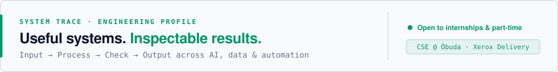
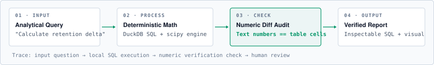
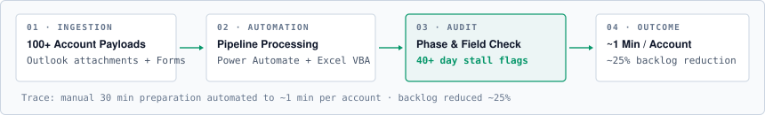
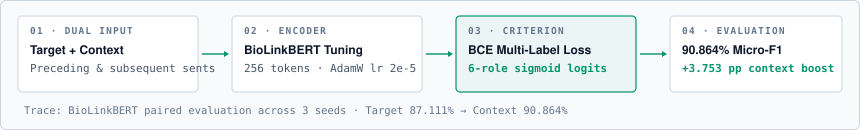

# Muhammad Ikram Hafeez

<picture>
  <source media="(prefers-color-scheme: dark)" srcset="assets/profile/trace-masthead-dark.svg">
  
</picture>

  <strong>Computer Science &amp; Engineering student building AI, data and automation systems.</strong> 
  Budapest, Óbuda University. In industry, I build reporting automations and operational audits at Xerox Client Delivery (100+ accounts). In research, I evaluate context-aware transformer backbones on clinical trials.

  <strong>Open to internships and part-time engineering roles in AI, data and automation.</strong> 
  <a href="https://im-kaami.github.io/">Portfolio</a> &nbsp;&middot;&nbsp; <a href="https://github.com/im-kaami">Code</a> &nbsp;&middot;&nbsp; <a href="https://im-kaami.github.io/contact.html">Contact</a> &nbsp;&middot;&nbsp; <a href="https://linkedin.com/in/ikram-hafeez">LinkedIn</a>

---

### Trace 01 &middot; Deterministic Analytics Engine (InsightForge AI)

<picture>
  <source media="(prefers-color-scheme: dark)" srcset="assets/profile/trace-insightforge-dark.svg">
  
</picture>

Input queries are compiled into DuckDB SQL and statistical code. Outputs are computed deterministically; an internal verification pass flags any summary claim differing from table cells before user review.

&rarr; [Inspect repository](https://github.com/im-kaami/InsightForgeAI) &nbsp;&middot;&nbsp; [Technical architecture](https://im-kaami.github.io/projects.html#insightforge)

---

### Trace 02 &middot; Operational Automation Pipeline (Xerox Client Delivery)

<picture>
  <source media="(prefers-color-scheme: dark)" srcset="assets/profile/trace-xerox-dark.svg">
  
</picture>

Ingests multi-account payloads across Outlook, Microsoft Forms and SharePoint. Automated extraction and formatting via Power Automate and Excel VBA cuts report preparation from ~30 minutes to ~1 minute per account. Separate operational audit workflows flag devices stalled 40+ days, helping reduce backlog by ~25%.

Author of the dashboard SOP/user guide; instructor for an internal Excel course covering basics through intermediate topics.

&rarr; [Reporting pipeline](https://im-kaami.github.io/experience/xerox/reporting-automation.html) &nbsp;&middot;&nbsp; [Device tracking audit](https://im-kaami.github.io/experience/xerox/device-tracking.html) &nbsp;&middot;&nbsp; [Request automation](https://im-kaami.github.io/experience/xerox/device-requests.html)

---

### Trace 03 &middot; Contextual Classification Pipeline (BIORC800 NLP)

<picture>
  <source media="(prefers-color-scheme: dark)" srcset="assets/profile/trace-biorc800-dark.svg">
  
</picture>

Dual-window context ingestion (+/- 1 surrounding sentence) with BioLinkBERT evaluated on official BIORC800 splits (18 total runs, 3 seeds). Context yields a +3.753 pp mean Micro-F1 gain (87.111% target-only &rarr; 90.864% context mean; 91.183% single-seed peak).

Secondary PubMed RCT benchmark: SciBERT reached 85.65% accuracy versus 84.20% for BERT on 20k abstracts.

&rarr; [Experimental trace and results](https://im-kaami.github.io/research.html)

---

### Team Engineering &amp; Coursework

- **[VeriVision](https://github.com/mariasiles/VeriVision)** (HPI Potsdam Sprint) &mdash; Multimodal verification pipeline for claims and social media video links with ranked source retrieval (team of four; Python, FastAPI, React, faster-whisper).
- **[Campus Copilot](https://im-kaami.github.io/projects.html#campus-copilot)** (Óbuda AI Campus) &mdash; Led team of three building a retrieval-augmented system grounded in university documentation.
- **[AI Earphone](https://github.com/LiRongchuan/raspbot-public)** (SUSTech) &mdash; Wearable sensor project (fall detection, PPG heart-rate monitoring, voice interaction).
- **[Telecom Carrier Analysis](https://im-kaami.github.io/projects.html#telecom)** (NED) &mdash; Power BI tariff analysis across 244 destinations and ~584M call minutes; analytical routing recommendations.

[Explore all project traces &rarr;](https://im-kaami.github.io/projects.html)

---

### Background &amp; Systems Stack

- **Experience:** Automation &amp; Data Analytics Intern @ Xerox Client Delivery (Aug 2025 &ndash; Present); AI Research Assistant @ Óbuda University AMLRG (Sep 2025 &ndash; Present); Student Mentor @ Milestone Institute &amp; HÖOK; Lead @ SHS_PK Community.
- **Education:** BSc Computer Science &amp; Engineering, Óbuda University (Sep 2023 &ndash; Aug 2027 &middot; GPA 4.71 / 5.00); Diploma in Data Science with AI, NED University (2025 &ndash; Present &middot; CGPA 3.87 / 4.00). Stipendium Hungaricum.
- **Tools:**
  - *AI &amp; NLP:* Python &middot; PyTorch &middot; Transformers &middot; scikit-learn &middot; LoRA / PEFT &middot; RAG
  - *Data &amp; Analytics:* SQL &middot; DuckDB &middot; Power BI &middot; Power Query &middot; DAX &middot; pandas &middot; Plotly
  - *Automation &amp; Delivery:* Power Automate &middot; Forms &middot; Excel VBA &middot; SharePoint &middot; FastAPI &middot; Next.js &middot; Docker

 

Budapest, Hungary &nbsp;&middot;&nbsp; <a href="mailto:hafeez.muhammadikram@outlook.com">hafeez.muhammadikram@outlook.com</a> &nbsp;&middot;&nbsp; <a href="https://im-kaami.github.io/">Portfolio</a> &nbsp;&middot;&nbsp; <a href="https://linkedin.com/in/ikram-hafeez">LinkedIn</a>

